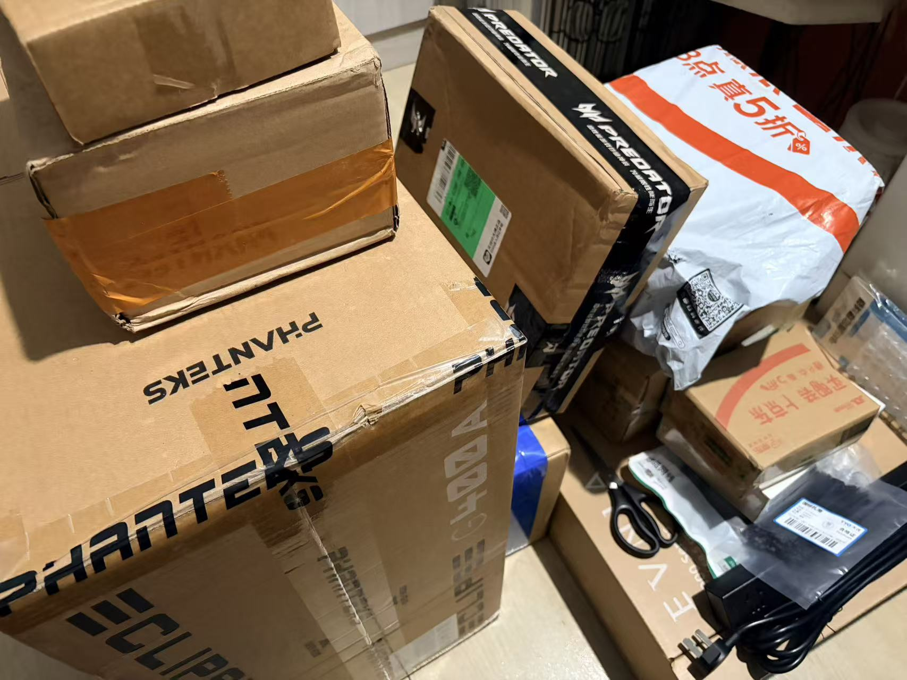
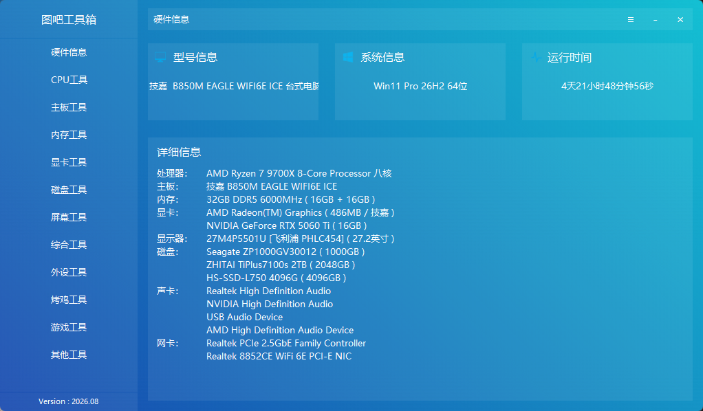
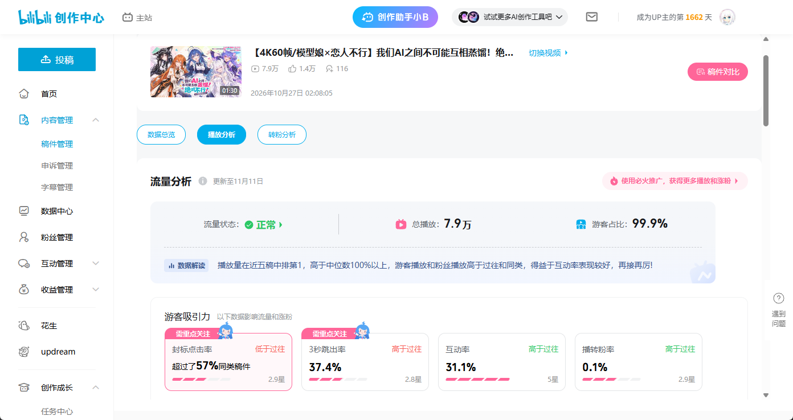
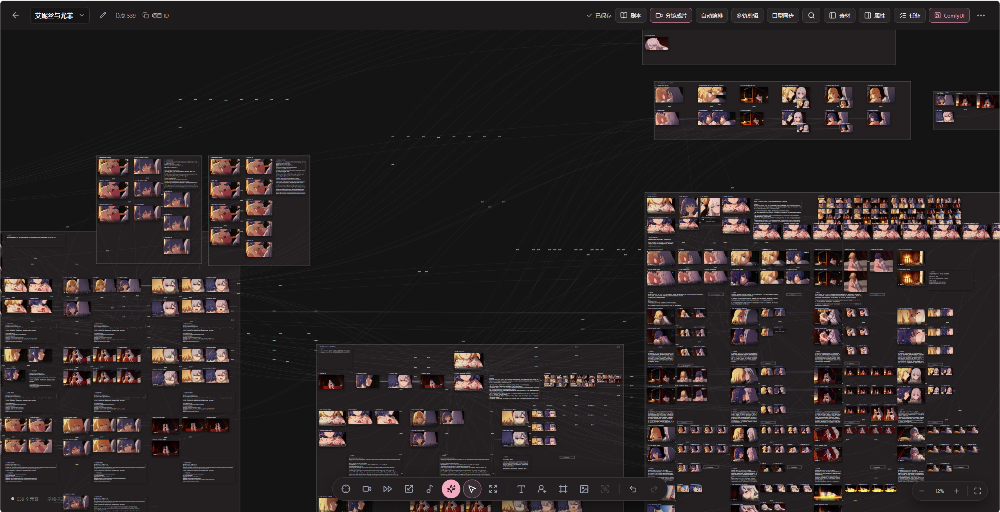

## # 前言

好久没更新博客了。最近事情有点多，手头的项目有些还在跑，有些就先放一放。亦可YK 的 LLM 和云视频模块已经先下架了，本来也主要是我自己用，暂时没必要对外开放。老主机早就能跑 AI 生图，亦可YK 部署在上面的服务也一直挂着，我最近没怎么去动它。

DSH 插件这边，我也停掉了一些原本打算做的东西。现在社区里的插件已经挺丰富了，很多需求都有人做。再让我坐那儿硬想几个新点子，估计也想不出来，就先把时间留给自己眼下真的想做的事。

## # 新主机和一条意外小火的视频

最近组了台新主机，打算拿来打游戏，也想在本地折腾 AI 视频。配置是 Ryzen 7 9700X、RTX 5060 Ti 16GB 和 32GB DDR5 内存。老机器上已经玩过生图了，这回最馋的是 MiniMax H3 的视频生成，惦记好一阵了。[MiniMax H3 官方介绍](https://www.minimax.io/blog/minimax-h3)

一开始，我就想让 Codex 搭把手，做一个《恋人不行》的 AI 娘化版。做完传到 B 站，没想到还小火了一下。写这篇的时候，后台已经有 **7.9 万播放**，比我预想的热闹多了。

## # 做视频做到自己写画布

成片只有一分半，工程文件却已经大得有点夸张。让 AI 逐帧检查一段视频，得先拆成一张张图。改完再验一遍，又会拆出一批帧。想看两个镜头接起来顺不顺，还得把两段视频临时拼起来预览。很多地方看着是在引用同一份素材，实际上每用一次就多了一份副本。来回几轮，光是中间产物就堆了不少。

既然都打算在本地折腾了，我索性给自己写了个本地无限画布，把分镜、参考图和生成出来的片段摆到一起。跟 Codex 说要改哪里时，我可以指着具体的镜头和参考图交代，也方便把改前改后的片段放在一起看。现在还是边做视频边改画布，哪一步反复做得最烦，就先回头改哪一步。

等自己用顺手一点，我想把画布和工作流一起开源。有余力的话，也想做一个在线版，让大家能把自己的画布发出来，互相预览、交流，看看同一段戏还能怎么做。视频生成先留在各自的机器上，给大家提供在线生视频的算力，我目前确实负担不起。

## # 一个人的时间就这么多

最近最明显的感受是，晚上多花点时间剪视频，插件就少改一点。回头去看服务，画布上还有一堆想修的地方。总有些事情得先放下，给现在最想做的事腾点时间。

如果你也在折腾本地 AI 视频，或者也受够了为同一段素材拆好几遍帧，欢迎来聊聊你是怎么做的。画布还在边用边改，要是有同样想做这件事的小伙伴，也欢迎一起折腾。
